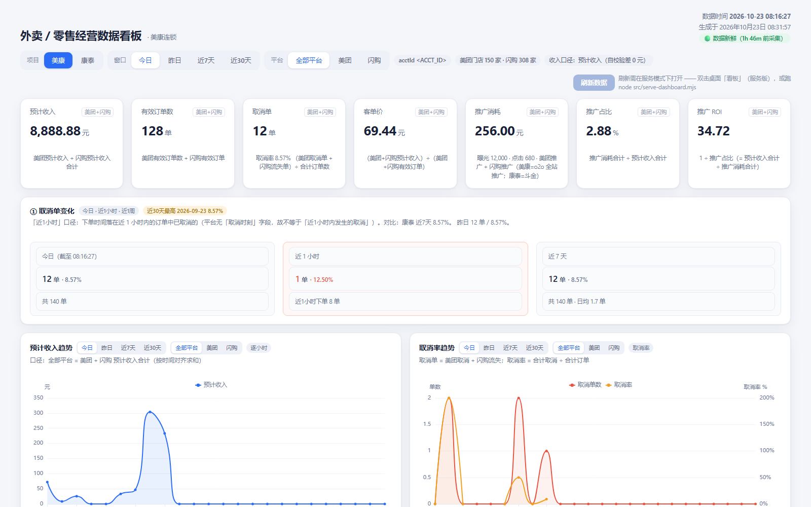

# waimai-ops-kit · 外卖经营数据套件

零售外卖门店经营数据闭环：从**美团医药 / 淘宝闪购**零售商家后台采集 → 生成**可双击打开的单文件看板** → **企微每日自动播报**。

> **无需编程基础。** 装好 AI agent（WorkBuddy / DeepSeek Harness 等）后，把本文档里的一段提示词丢给它，它会自己体检环境、装依赖、跑自检、告诉你在浏览器里点哪几下。



<sub>↑ 实际界面（数据为示例值，品牌与账号已脱敏）。七个 KPI 卡片按「平台 × 窗口」切换，下方是趋势与分时图。</sub>

---

## ⚠️ 先确认：这是给零售外卖的，不是给餐饮外卖的

| | 零售外卖（本套件适用） | 餐饮外卖（需自行改造） |
|---|---|---|
| 典型业态 | 药店、便利店、母婴、眼镜、美妆、鲜花 | 正餐、快餐、奶茶、烧烤 |
| 后台 | 美团医药商家端、淘宝闪购零售商家端 | 美团外卖商家版、饿了么商家版 |
| 页面结构 | 药品/商品 SKU 体系、门店台账 | 菜品/套餐体系、门店+档口 |
| 取数接口 | 本套件已标定并按此实现 | **完全不同，需重做取数层** |

**餐饮商家请注意**：本套件的看板渲染、播报、企微通道三层可以复用，但**取数层（`dashboard/src/fetch-*.mjs`、`broadcast/platforms/`）针对零售后台编写**，餐饮后台的页面结构、接口路径、字段体系都不同，直接拿来跑会失败。改造指引见 [`docs/09-零售与餐饮的差异.md`](docs/09-零售与餐饮的差异.md)。

> 不写「不支持餐饮」，是因为这三层架构本身是通用的 —— 只是取数层要换。你愿意折腾，就看得懂差异在哪。

---

## 这个套件给你什么

装完之后，你每天会得到三样东西：

1. **一个看板文件** —— 双击就开，断网也能看。营业额、订单、取消率、客单价、推广 ROI、门店营业状态，按平台（全部/美团/闪购）和窗口（今日/昨日/近7天/近30天）切换。
2. **每天早上 9:00 的企微播报** —— 推广账户余额（低于预警线提醒充值）+ 昨日经营结果 + 今日进度。
3. **群里随时能查** —— 在企微群 @机器人 发「余额」「门店」「订单」等固定命令，本地脚本直接回，不消耗 AI token。

---

## 怎么装（推荐：让 AI agent 带你做）

### 第 0 步：准备三样东西

| 需要的 | 说明 |
|---|---|
| 一台 Windows 电脑 | 开机时长机（建议常年不关；笔记本也行，但要设成不休眠） |
| 一个 AI agent | WorkBuddy、DeepSeek Harness（DSH）等能**执行命令**的 agent。只是聊天的 AI 不行 |
| 商家账号 | 美团医药商家端、淘宝闪购零售商家端，各一个账号 |

### 第 1 步：把这段提示词丢给 agent

复制下面整段，粘贴给你的 agent：

```text
我要在这台 Windows 电脑上部署 waimai-ops-kit（外卖零售经营数据套件）。
仓库地址：<把这里换成仓库的 GitHub 地址>

请按以下顺序做，每一步做完先告诉我结果，我确认后你再继续：

【第一步：体检】
1. 检查有没有 Node.js（版本要 ≥ 20）和 Python（≥ 3.10）。没有的话告诉我怎么装。
2. 检查能不能访问 github.com、registry.npmjs.org、pypi.org。不通就告诉我该配什么镜像。
3. 把仓库 clone 到一个我很方便找到的目录（不要放到 Program Files 里），告诉我最终路径。

【第二步：装依赖】
1. 进 dashboard/ 跑 npm install。
2. 进 broadcast/ 跑 pip install -r requirements.txt。
3. 依赖装不上就把完整报错贴给我，不要自己乱改版本号。

【第三步：填配置】
1. 把 broadcast/config.example.json 复制成 config.json。
2. 带我逐项填：两个平台各自的推广账户、企微群的 webhook 地址、预警线金额。
3. 每一项都告诉我"去哪儿找这个值"（比如 webhook 在群设置里的哪个菜单）。
4. 填完给我看一遍摘要（把 key 打码），我确认。

【第四步：登录两个浏览器】
1. 告诉我应该双击哪几个 .cmd 文件（每个对应哪个平台）。
2. 我登录完之后，你跑 npm run sessions 检查登录态，把结果告诉我。

【第五步：第一次取数】
1. 跑一次数据采集，把每个平台拿到多少门店、多少订单告诉我。
2. 哪一步失败了，把报错原文贴给我，并说明你判断是什么原因。

【第六步：生成看板】
1. 生成看板文件，告诉我它的完整路径，我要双击打开看。
2. 如果我看到的是空白页或报错，让你排查。

【第七步：定时任务】
1. 帮我把"每天 08:30 采集 + 09:00 播报"注册成 Windows 计划任务。
2. 注册完手动触发一次，确认能跑通。

全程注意：
- 每一步失败都停下来告诉我，不要跳过，不要用"大概能用"糊弄过去。
- 涉及我的账号密码、cookie、webhook key，不要打印全文，只显示前几位。
```

### 第 2 步：跟着 agent 走，遇到这些点要你亲手做

有三件事 agent 做不了，必须你自己来（它会提醒你）：

| 什么时候 | 你要做什么 |
|---|---|
| 第四步 | **在两个弹出的浏览器窗口里手动登录**（美团一个、闪购一个）。登录态存在浏览器里，agent 碰不到密码 |
| 第七步 | 如果计划任务注册失败（提示权限不足），用**管理员身份**重跑一次，或改用「启动文件夹」方案 |
| 任何时候 | 后台改版导致取数失败 —— 见下面的「维护」 |

---

## 装完之后，每天早上看到什么

```
**推广账户余额播报**

**示例大药房**
· **淘宝闪购**　¥908.20 ／ 预警线 ¥200.00
· **美团**　¥656.18 ／ 预警线 ¥200.00

**今日经营**
· **示例大药房**　预计收入 ¥2,595.94｜有效订单 115｜取消率 6.61%｜推广消耗 ¥75.49
```

**看到 ⚠️ 低于预警线就去充值** —— 这是这个套件最值钱的一条：钱烧完了，推广就停了，订单一夜之间掉光。

---

## 出问题了怎么办

| 你看到的 | 意思是 | 怎么办 |
|---|---|---|
| 播报里「取数失败」 | 某个平台的登录态或接口挂了 | 告诉 agent：「播报里 XX 平台取数失败，帮我看看」，或看 [`docs/05-排查手册.md`](docs/05-排查手册.md) |
| 看板双击打不开 | 文件没生成全 | 让 agent 重跑一次生成 |
| 数字明显不对 | 口径问题（比如把成交额当收入） | 见 [`docs/03-口径说明.md`](docs/03-口径说明.md) |
| 早上一片「取数失败」 | 常见于电脑休眠过 / 浏览器被关 | 让 agent 跑登录态检查，按提示重开浏览器 |

---

## 关于维护（请先读这段再决定用不用）

**这个套件依赖平台后台的私有接口，平台改版就可能失效。**

- 本仓库**随作者的零售业务需要更新**，不承诺跟进每一次平台改版。
- 接口失效时的典型表现：某个平台突然全体「取数失败」、或者拿到的数字全是 0/空。
- 你能做的最有效的事：**发现失效时到 Issue 里贴报错日志**（不要只写「用不了了」），作者或社区能更快定位。

这个风险是真的 —— 作者自己在 2026-09-24 就遇到过美团某族接口整体失效，被迫迁移到另一条通路。**把它当成"需要一个懂行的人偶尔看一眼"的工具，而不是装了就不用管的设备。**

---

## 目录结构

```
waimai-ops-kit/
├── dashboard/          看板：采集 + 渲染成单文件 HTML
│   ├── src/fetch-*.mjs     各平台取数脚本
│   ├── src/lib/            口径真相源（caliber.mjs）、CDP、cookie 处理
│   └── src/template/       看板模板（按文件名排序拼成单一文件）
├── broadcast/          播报：余额 + 经营指标推送到企微
│   ├── bot.py              主程序
│   ├── platforms/          各平台余额取数
│   └── core/               浏览器、凭据、企微推送
├── docs/               部署、口径、排查等文档
└── tools/guard/        提交守卫：扫描敏感信息（开发者用）
```

---

## 给开发者

- **架构**：取数层 → 落盘 JSON → 纯函数装配 → 渲染。口径常量只有 `dashboard/src/lib/caliber.mjs` 一个真相源。
- **两条不能破的契约**：① 看板是自包含单文件（断网可用）；② 两个平台严格故障隔离（一边挂了另一边照常出数）。
- **提交前**跑 `node tools/guard/scan.mjs`，它会拦住真实店名、凭据、个人路径。
- **改了模板或装配逻辑**必须重跑 parity 校验，详见 `dashboard/package.json` 里的脚本。

## License

MIT
